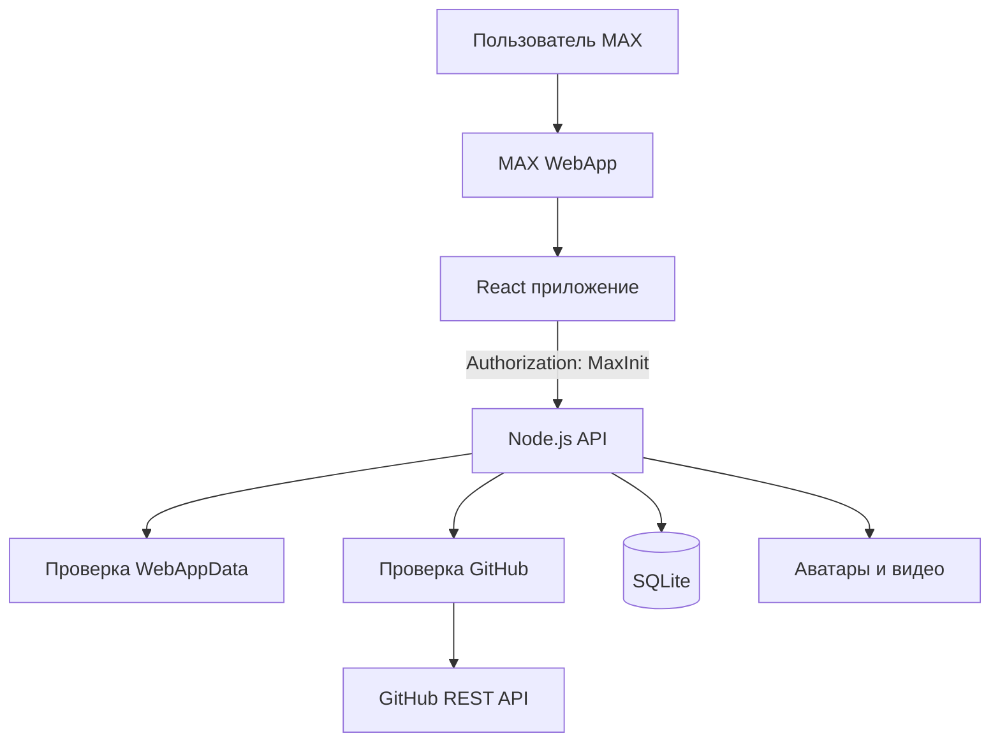

# Архитектура EDU

## Компоненты



Frontend и API развёртываются одним контейнером. Nginx завершает HTTPS и передаёт запросы на локальный порт приложения. API отдаёт собранный frontend, JSON и медиа.

## Доверительные границы

1. Клиент не рассчитывает XP, права или статус задания. Сервер возвращает итоговое состояние.
2. Сервер проверяет подпись MAX и срок `auth_date` на каждом защищённом запросе.
3. Пользователь определяется только по подписанным данным MAX.
4. Токен бота и GitHub-токен не передаются в браузер.
5. Присланный код не выполняется. Сервер читает только метаданные публичного репозитория через GitHub API.
6. Начисление XP и открытие уровня выполняются в транзакции SQLite.

## Хранение данных

SQLite хранит профили, настройки, прогресс, проекты, заявки, мероприятия, публикации, реакции и результаты проверок. Файловая система хранит пользовательские аватары и видео. В Docker оба типа данных находятся в томе `app_data`.

## Production

```mermaid
flowchart LR
    Internet -->|HTTPS 443| Nginx
    Nginx -->|127.0.0.1:3101| EDU[EDU service]
    EDU --> Data[/var/lib/edupodoroge]
    EDU --> Github[api.github.com]
```

Для горизонтального масштабирования локальное хранилище нужно заменить на PostgreSQL и S3-совместимое объектное хранилище.
